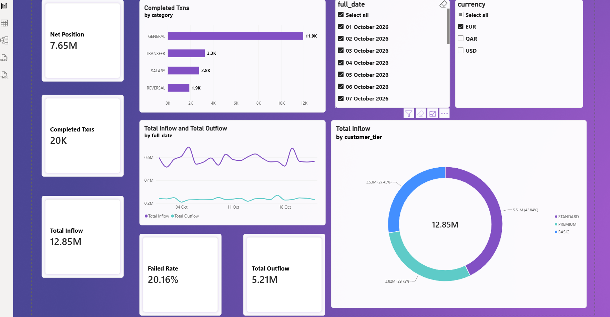
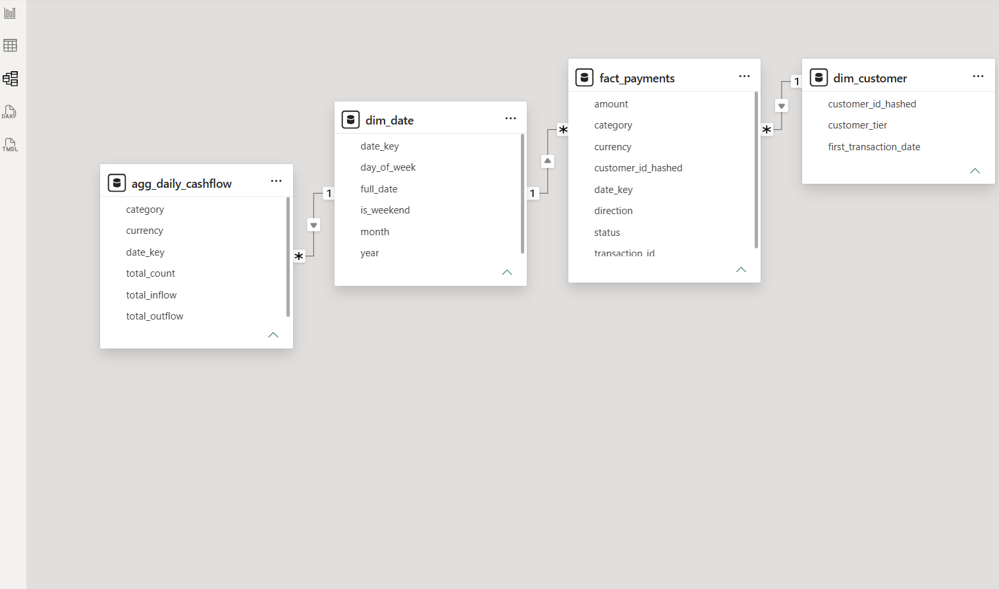
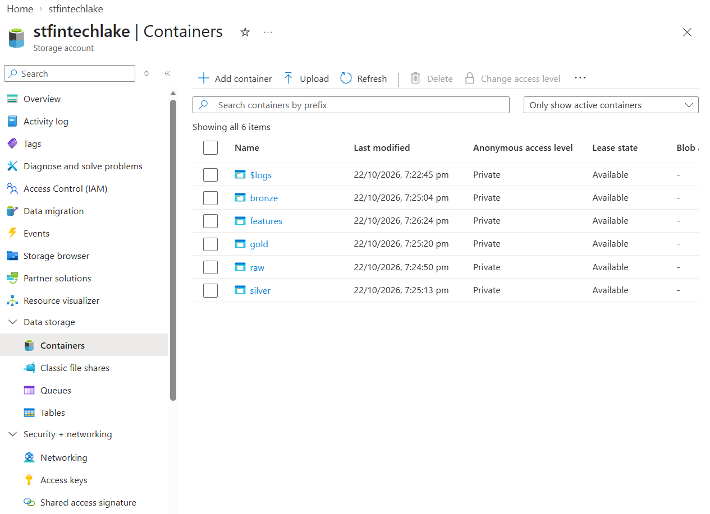
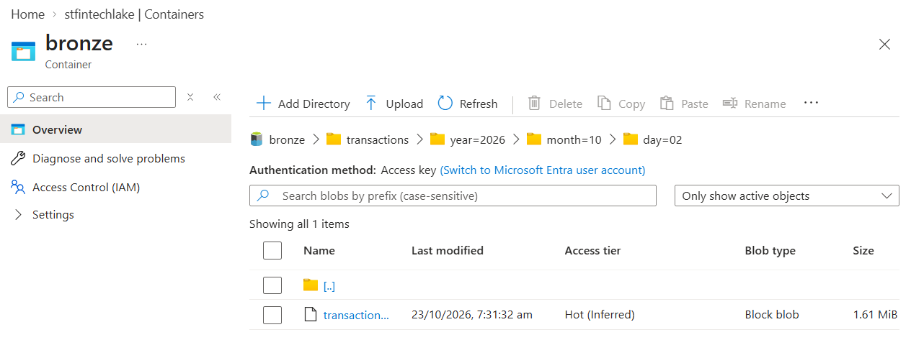
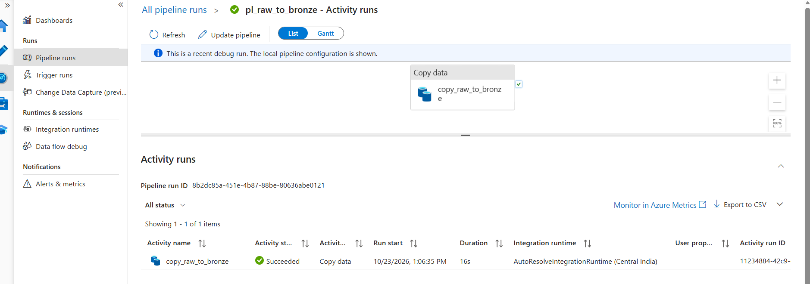
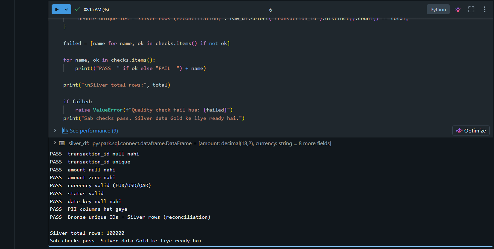
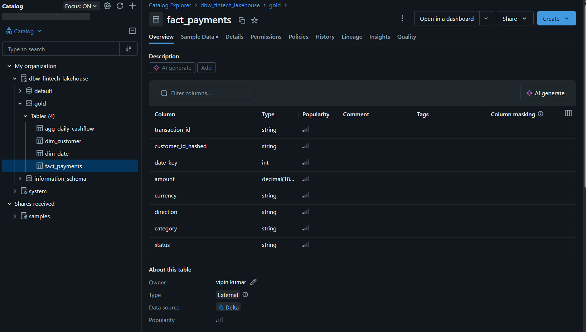

# FinTech Payments Lakehouse Platform on Azure

An end-to-end data engineering project that ingests payment transactions into an Azure data lake, cleans and anonymises them with PySpark and Delta Lake, models them as a star schema, and serves them through a Power BI dashboard. It follows the **Medallion Architecture** (Bronze → Silver → Gold).

> **Note:** All data is synthetic, generated with Python's Faker library. No real customer data is used.



---

## Highlights

- **100,000** synthetic transactions across **2,000** customers and **22 days**, in CSV and JSON
- **Medallion architecture** on Azure Data Lake Storage Gen2 with date-partitioned Bronze storage (`year=/month=/day=`)
- **Idempotent Silver load** using Delta Lake `MERGE`, so re-running the pipeline never creates duplicates
- **PII protection:** customer identifiers are salted SHA-256 hashed; name, email and IBANs are dropped before Silver
- **Automated quality gate:** 9 checks, including a Bronze-to-Silver reconciliation, that stop the pipeline on failure
- **Star schema** (1 fact, 2 dimensions, 1 aggregate) served to Power BI with DAX measures

---

## Architecture

```
 Synthetic data (Python + Faker)
        │  CSV / JSON
        ▼
 ┌─────────────────────┐
 │  RAW  (ADLS Gen2)   │  files as generated
 └──────────┬──────────┘
            │  Azure Data Factory (Copy activity, preserve hierarchy)
            ▼
 ┌─────────────────────┐
 │  BRONZE             │  immutable JSON, partitioned by year/month/day
 └──────────┬──────────┘
            │  Azure Databricks (PySpark)
            ▼
 ┌─────────────────────┐
 │  SILVER (Delta)     │  deduplicated, typed, PII hashed, categorised
 └──────────┬──────────┘
            │  Data quality gate (9 checks + reconciliation)
            ▼
 ┌─────────────────────┐
 │  GOLD (Delta)       │  dim_date, dim_customer, fact_payments,
 │                     │  agg_daily_cashflow
 └──────────┬──────────┘
            │  Unity Catalog + Databricks SQL Warehouse
            ▼
      Power BI (Import mode)
```

Secrets (the PII hashing salt) are stored in **Azure Key Vault**. Services authenticate with **Managed Identities** and RBAC roles instead of keys.

---

## Tech stack

| Layer | Tools |
|---|---|
| Storage | Azure Data Lake Storage Gen2 (hierarchical namespace), Delta Lake |
| Ingestion | Azure Data Factory (linked services, datasets, Copy activity) |
| Processing | Azure Databricks (serverless), PySpark, Delta `MERGE` |
| Governance | Unity Catalog (external locations, storage credential), Azure Key Vault, Managed Identity |
| Serving | Databricks SQL Warehouse, Power BI Desktop, DAX |
| Data generation | Python, Faker, pandas |

---

## Data model (Gold)



| Table | Grain | Rows |
|---|---|---|
| `fact_payments` | one row per transaction | 100,000 |
| `dim_customer` | one row per (hashed) customer, with a volume-based tier | 2,000 |
| `dim_date` | one row per calendar day | 22 |
| `agg_daily_cashflow` | date × currency × category (COMPLETED transactions only) | 264 |

---

## Pipeline walkthrough

### 1. Data lake layout
Containers for each layer (`raw`, `bronze`, `silver`, `gold`, `features`), with Bronze partitioned by date so queries scan only the days they need.




### 2. Ingestion (Azure Data Factory)
A Copy activity moves JSON files from `raw` to `bronze` using a wildcard source and **Preserve hierarchy**, so the partition folders carry over. The files are copied as Binary, which keeps Bronze unaltered.



### 3. Silver (Databricks + Delta Lake)
- Remove duplicates on `transaction_id`
- Cast `amount` to `decimal(18,2)` and parse timestamps; derive `date_key`
- Derive `direction` (INFLOW/OUTFLOW) and `category` (SALARY, TRANSFER, REVERSAL, GENERAL)
- Replace `customer_id` with a salted SHA-256 hash and drop name, email and IBAN columns
- Write to Delta with `MERGE INTO` so the load is idempotent

### 4. Data quality gate
Nine checks run before Gold is built. Any failure raises an error and stops the pipeline.



Checks cover null and unique `transaction_id`, null and zero `amount`, valid `currency` and `status`, null `date_key`, PII columns removed, and a **reconciliation** that Bronze unique IDs equal Silver rows.

### 5. Gold and Unity Catalog
Gold tables are written as Delta and registered as external tables in Unity Catalog (`dbw_fintech_lakehouse.gold`).



### 6. Power BI
Connected through a Databricks SQL Warehouse in Import mode, with two one-to-many relationships from the dimensions to the fact table.

DAX measures (completed transactions only; outflow amounts are stored as negatives, so `Total Outflow` flips the sign):

```dax
Total Inflow  = CALCULATE(SUM(fact_payments[amount]), fact_payments[direction] = "INFLOW",  fact_payments[status] = "COMPLETED")
Total Outflow = -CALCULATE(SUM(fact_payments[amount]), fact_payments[direction] = "OUTFLOW", fact_payments[status] = "COMPLETED")
Net Position  = [Total Inflow] - [Total Outflow]
Completed Txns = CALCULATE(COUNTROWS(fact_payments), fact_payments[status] = "COMPLETED")
Failed Rate   = DIVIDE(CALCULATE(COUNTROWS(fact_payments), fact_payments[status] = "FAILED"), COUNTROWS(fact_payments))
```

The Power BI Net Position was checked against the sum computed directly in Databricks, and the two matched.

---

## Sample insights (EUR, synthetic data)

- Total inflow 12.85M vs outflow 5.21M, giving a net position of 7.65M
- 20K completed transactions; `GENERAL` is the largest category (11.9K), followed by `TRANSFER` (3.3K), `SALARY` (2.8K) and `REVERSAL` (1.9K)
- About 20% of transactions fail, which is by design in the generated data
- Inflow by customer tier: STANDARD 42.8%, PREMIUM 29.7%, BASIC 27.5%

---

## Design decisions

- **Delta tables instead of a Synapse Dedicated SQL Pool for Gold.** Dedicated pools are expensive and keep billing while running. The star schema is the same, and it is served through Databricks SQL.
- **Binary copy for Bronze.** Guarantees the raw data is not altered in transit.
- **Salted hashing, not encryption.** Hashes keep customer-level analysis possible (same customer, same hash) without exposing identity.
- **Import mode in Power BI.** The dataset is small, so Import is faster and avoids keeping a warehouse running.
- **Currencies are not converted.** The data mixes EUR, USD and QAR, so the dashboard filters by currency. A production system would add exchange rates.

---

## Limitations and next steps

- Bronze (`raw` and `bronze` containers) still holds the original PII by design. In a real system access to these layers would be tightly restricted.
- Quality checks are written in plain PySpark rather than Great Expectations.
- The steps are currently run manually or via a debug run.

**Roadmap**
- [ ] ADF master pipeline: Ingest → Silver → Quality → Gold, with a trigger and failure alert
- [ ] 30-day rolling customer features exported as Parquet (`features` container)
- [ ] CI/CD with GitHub Actions
- [ ] Azure Monitor alerts on pipeline failures
- [ ] Slowly Changing Dimension (Type 2) for `dim_customer`

---

## Repository structure

```
.
├── README.md
├── images/                    # screenshots used in this README
├── src/
│   ├── generate_data.py       # synthetic data generator
│   ├── silver_clean.py        # Bronze → Silver (PySpark + Delta MERGE)
│   ├── quality_checks.py      # data quality gate
│   └── gold_build.py          # Silver → Gold star schema
├── powerbi/
│   ├── measures.dax
│   └── fintech_dark_theme.json
└── docs/
    └── architecture.md
```

## How to run

1. Generate data: `pip install faker pandas && python src/generate_data.py`
2. Upload `out/transactions` to the `raw` container.
3. Run the ADF pipeline `pl_raw_to_bronze` to populate Bronze.
4. Run the Databricks notebooks in order: Silver, quality checks, Gold. Pass the hashing salt through a notebook widget (never commit it).
5. Open the Power BI file, point it at your SQL Warehouse, and refresh.

> **Security:** Never commit secrets, access keys, tokens or the hashing salt to this repository. Store them in Azure Key Vault.

---

## Author

**Vipin Kumar** · Data Analyst · Advanced Excel, Power BI, SQL, Python
[LinkedIn](https://www.linkedin.com/in/your-profile) · [GitHub](https://github.com/your-username)
